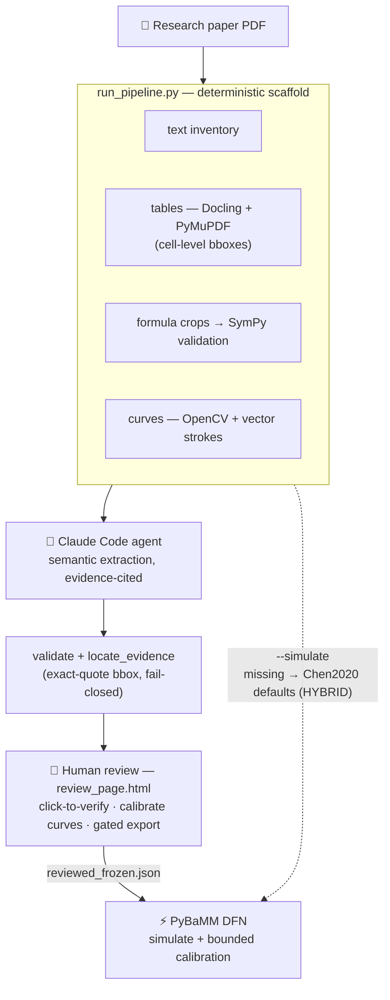

<div align="center">

# ⚡ TraceCell

**Evidence-first DFN/P2D parameter extraction, human-in-the-loop review, and PyBaMM simulation — straight from battery research papers.**

[English](README.md) · [简体中文](README.zh-CN.md)


</div>

---

## ✨ Highlights

- 📄 **Paper-first** — every extracted value must trace to an exact PDF quote, page and bounding box. Nothing is ever sourced from model code, repositories, or internet snippets.
- 🔍 **Deterministic parsing** — text inventory, structured tables (Docling + PyMuPDF, cell-level bboxes), formula crops for visual reconstruction with SymPy validation, WebPlotDigitizer-style curve digitization (OpenCV raster + exact PDF vector strokes).
- 👀 **Mandatory human review** — a fully self-contained HTML page: click a parameter to jump to its PDF highlight, verify table/formula/curve evidence, calibrate curves, export a gated JSON. `VERIFIED` is a human-only status.
- ⚡ **PyBaMM DFN simulation** — one command runs a baseline isothermal DFN discharge; parameters without a value fall back to the Chen2020 default set, and every such run is conspicuously labeled **HYBRID, NOT a paper reproduction**. Bounded least-squares calibration against a digitized curve is built in.
- 🚧 **Fail-closed by design** — ambiguity stays unresolved, unreviewed values never enter a simulation, and calibrated fits are never fed back as paper evidence.

> ⚠️ **Critical limitation:** the deterministic tools never extract scientific values by themselves. Claude Code performs the scientific reading step with cited evidence, and a human grants `VERIFIED` by clicking in the review page. This package ships a workflow + tooling, not a pretrained extraction model.

## 🧭 Pipeline



## 🗂 Project structure

```text
p2d-dfn-research-skill/
├── SKILL.md                          # agent instructions, guardrails, output contract
├── assets/
│   ├── parameter_dictionary.json     # 45 candidate baseline DFN entries (with pybamm_name)
│   └── review_template.html          # the human-in-the-loop review UI (V2)
├── scripts/
│   ├── run_pipeline.py               # one-command scaffold (+ --simulate)
│   ├── table_parser.py        (P0)   # Docling + PyMuPDF dual engine, per-cell bbox, crops
│   ├── formula_parser.py      (P0)   # candidate scan + SymPy validation
│   ├── curve_digitizer.py     (P1)   # raster/vector scan, calibration apply → CSV
│   ├── skill_cli.py                  # template / inventory / validate / compare
│   ├── locate_evidence.py            # exact-quote localization (fail-closed)
│   ├── build_review_page.py          # bundles everything into one self-contained HTML
│   ├── recover_from_review_page.py   # reverse a review page back into run artifacts
│   └── pybamm_adapter.py             # reviewed JSON → DFN overrides → simulate / calibrate
├── references/                       # WORKFLOW.md, PARAMETER_POLICY.md
├── examples/                         # synthetic smoke PDF + extraction (not real research)
├── tests/                            # pytest smoke suite
└── work/<doc-id>/                    # per-paper run directory (git-ignored)
```

<details>
<summary>Inside a per-paper run directory <code>work/&lt;doc-id&gt;/</code></summary>

| Location | Contents |
| --- | --- |
| root | `pages.json` / `tables.json` / `formulas_scan.json` / `curves_scan(_all).json` / `paper_extracted.json` / `review_ready.json` + crop dirs |
| `review/` | `review_page.html`, `reviewed.json`, `reviewed_frozen.json`, `freeze_meta.json` |
| `sim/` | `simulation_report.json`, `sim_<c>C.csv/png`, `calibration_report.json` |
| `curves/`, `calibrations/` | digitized curve CSVs and calibration records |
| `table_crops/` `formula_crops/` `curve_crops/` | evidence crops — referenced by relative path, never rename |

</details>

## 📦 Installation

```bash
git clone <this-repo> && cd p2d-dfn-research-skill
python -m pip install -r requirements.txt
python -m pytest -q          # smoke suite (PyBaMM tests auto-skip if unavailable)
```

Python 3.10+. As a Claude Code skill, copy the directory to `~/.claude/skills/p2d-dfn-research/` (or your project's `.claude/skills/p2d-dfn-research/`) — the skill id stays `p2d-dfn-research`. **Do not provide parameter source code before the independent paper extraction is frozen.**

## 🚀 Quick start

```bash
# 1) deterministic scaffold — one command, one run dir per paper
python scripts/run_pipeline.py --pdf paper.pdf --doc-id Chen2020 --pages 12,19,21

# 1b) same scaffold + a baseline simulation at the very end.
#     No reviewed JSON yet → missing parameters use Chen2020 defaults (HYBRID, labeled);
#     after human review/freeze it automatically picks up review/reviewed*.json instead.
python scripts/run_pipeline.py --pdf paper.pdf --doc-id Chen2020 --simulate --c-rate 1.0 --cut-voltage 3.0

# 2) agent fills work/Chen2020/paper_extracted.json  (semantic extraction with evidence)
python scripts/skill_cli.py validate --input work/Chen2020/paper_extracted.json \
  --output work/Chen2020/validation.json
python scripts/locate_evidence.py --pdf paper.pdf --input work/Chen2020/paper_extracted.json \
  --dictionary assets/parameter_dictionary.json --tables work/Chen2020/tables.json \
  --output work/Chen2020/review_ready.json
python scripts/build_review_page.py --review-ready work/Chen2020/review_ready.json \
  --tables work/Chen2020/tables.json --formulas work/Chen2020/formulas_validated.json \
  --curves work/Chen2020/curves_scan_all.json --pdf paper.pdf \
  --output work/Chen2020/review/review_page.html

# 3) HUMAN opens the review page: click through 45 parameters, verify evidence,
#    calibrate curves, export reviewed JSON

# 4) freeze -> compare -> simulate (see next section)
```

Full command reference: [`references/WORKFLOW.md`](references/WORKFLOW.md).

## ⚡ Simulation & calibration

**End of pipeline (recommended):** `run_pipeline.py --simulate` (above) drops everything into `work/<doc-id>/sim/` — `simulation_report.json`, `sim_<c>C.csv`, `sim_<c>C.png`. A failed solve still writes a `FAILED` report and exits non-zero.

**Direct adapter use** (after freezing the reviewed JSON):

```bash
W=work/Chen2020
# 1C discharge of the reviewed parameter set
python scripts/pybamm_adapter.py --reviewed $W/review/reviewed_frozen.json \
  --output $W/sim/simulation_report.json --run --c-rate 1.0 --cut-voltage 2.5 --curve-csv $W/sim/sim_1C.csv

# bounded calibration ("自动仿真训练") against a digitized paper curve
python scripts/pybamm_adapter.py --reviewed $W/review/reviewed_frozen.json \
  --output $W/sim/calibration_report.json --run --calibrate \
  --target $W/curves/fig17_1C_discharge_target.csv \
  --fit negative_particle_diffusivity:log_scale,positive_particle_diffusivity:log_scale \
  --curve-csv $W/sim/sim_1C_calibrated.csv
```

How values enter the model — and what never does:

- **Applied (VERIFIED only):** scalars, SymPy-compiled function expressions (`expr://sym:…`), digitized-curve Interpolants (`data://curve:…`, arguments clamped to the digitized domain).
- **Blocked:** reaction-rate **coefficients** (m_k) are never injected as constant j0 — the function shape must be implemented manually.
- **Defaulted:** anything without a human-verified value falls back to the Chen2020 baseline; the report's `hybrid_warning` states the fill count (e.g. `45/45` before review). Every such run is a **HYBRID experiment, never a reproduction**.
- **Calibrated:** fitted values are labeled `CALIBRATED_SIMULATION_FIT` — never cite them as paper evidence, never feed them back into the extraction JSON.

## 👀 Human-in-the-loop review page

`review_page.html` is fully self-contained (no server, nothing uploaded):

- **参数审核清单** with search/filter/status chips, keyboard shortcuts (↑/↓, Enter=确认, C=冲突), progress bar
- **PDF viewer** (PDF embedded as base64) with exact-quote bbox highlights, parser-table-cell highlights (labeled separately), numbered ambiguous-candidate boxes
- **表格证据**: click a parsed cell → adopts text + page + bbox as that parameter's evidence
- **公式证据**: crop image + reconstructed SymPy source + check chips → 核对无误 / 有疑问 / 绑定到参数
- **曲线标定**: click ≥2 axis reference points per axis, enter tick values, preview the mapped CSV, confirm → binds as `data://curve:…` with full provenance (the **only** path a curve becomes data)
- **导出门禁**: export is blocked while parameters remain PENDING; forcing requires a written gap reason that lands in the exported JSON
- progress autosaves to localStorage (per-viewer convenience only)

## ⚠️ Scientific integrity & accepted constraints

- Target classic isothermal **DFN/P2D** only — no SEI, plating, LAM, fracture or thermal/aging models.
- Exact-quote localization requires a searchable text layer; scanned tables need human checking or optional layout parsing. Matches stay unresolved when ambiguous — never guessed.
- `compare` does same-unit numeric comparisons only; function shapes are compared numerically in a separate report. It is not a scientific-equivalence engine.
- The 45-entry dictionary is a candidate template, **not** a verified complete dependency set for a pinned PyBaMM release — run a version-locked dependency check before production use.
- Digitized curves inherit calibration error (worst on steep regions); provenance headers quantify residuals and human approval status.
- Formula `VALIDATED` means mathematically consistent — **not** that it matches the paper; a human verifies against the crop.

## 🙏 Acknowledgments

Built on [PyBaMM](https://github.com/pybamm-team/PyBaMM), [Docling](https://github.com/docling-project/docling), [PyMuPDF](https://github.com/pymupdf/PyMuPDF) and [OpenCV](https://github.com/opencv/opencv); curve digitization follows the WebPlotDigitizer approach. Designed as a [Claude Code](https://claude.com/claude-code) skill.

## License

TBD — do not redistribute publicly until a license is chosen.
