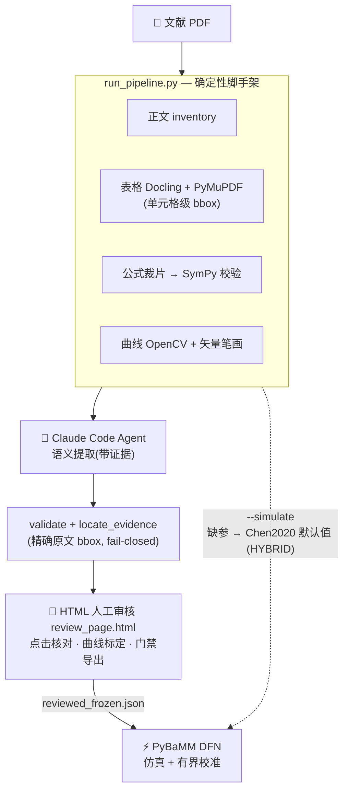

<div align="center">

# ⚡ TraceCell

**证据优先的 DFN/P2D 参数提取、人工审核与 PyBaMM 仿真 —— 直接从电池研究论文出发。**

[English](README.md) · [简体中文](README.zh-CN.md)


</div>

---

## ✨ 特性

- 📄 **论文优先** —— 每个提取值都必须溯源到 PDF 精确原文、页码与包围盒；绝不取自模型代码、仓库或网络片段。
- 🔍 **确定性解析** —— 正文清单、结构化表格（Docling + PyMuPDF 双引擎、单元格级 bbox）、公式裁片 + SymPy 校验、WebPlotDigitizer 思路的曲线数字化（OpenCV 栅格 + PDF 矢量笔画）。
- 👀 **强制人工审核** —— 完全自包含的 HTML 审核页：点参数跳到 PDF 高亮、核对表格/公式/曲线证据、标定曲线、门禁导出 JSON。`VERIFIED` 只能由人授予。
- ⚡ **PyBaMM DFN 仿真** —— 一条命令跑基线等温 DFN 放电；**没有数值的参数回退 Chen2020 默认集**，每次回退运行都显式标注 **HYBRID（混合，非论文复现）**；内置对数字化曲线的有界最小二乘校准（自动仿真训练）。
- 🚧 **失败即关闭（fail-closed）** —— 歧义保持未决、未经审核的值不进仿真、校准拟合值永不回写为论文证据。

> ⚠️ **关键局限：** 确定性工具本身不做科学取值。科学阅读由 Claude Code 完成且必须引用 PDF 证据，`VERIFIED` 由人在审核页点击授予。本包提供的是**工作流程与工具链**，不含预训练提取模型。

## 🧭 流水线



## 🗂 项目结构

```text
p2d-dfn-research-skill/
├── SKILL.md                          # Agent 指令、防护栏、输出契约
├── assets/
│   ├── parameter_dictionary.json     # 45 条候选基线 DFN 条目(含 pybamm_name)
│   └── review_template.html          # 人工审核 UI (V2)
├── scripts/
│   ├── run_pipeline.py               # 一条命令脚手架 (+ --simulate)
│   ├── table_parser.py        (P0)   # Docling + PyMuPDF 双引擎、逐格 bbox、裁片
│   ├── formula_parser.py      (P0)   # 公式候选扫描 + SymPy 校验
│   ├── curve_digitizer.py     (P1)   # 栅格/矢量扫描、标定换算 → CSV
│   ├── skill_cli.py                  # template / inventory / validate / compare
│   ├── locate_evidence.py            # 精确原文定位 (fail-closed)
│   ├── build_review_page.py          # 打包为单个自包含审核页
│   ├── recover_from_review_page.py   # 从审核页反解运行产物
│   └── pybamm_adapter.py             # 审核 JSON → DFN 参数覆盖 → 仿真/校准
├── references/                       # WORKFLOW.md、PARAMETER_POLICY.md
├── examples/                         # 合成冒烟 PDF 与提取(非真实研究)
├── tests/                            # pytest 冒烟套件
└── work/<doc-id>/                    # 每篇论文一个运行目录(已 git-ignore)
```

<details>
<summary>展开：运行目录 <code>work/&lt;doc-id&gt;/</code> 内部</summary>

| 位置 | 内容 |
| --- | --- |
| 根 | `pages.json` / `tables.json` / `formulas_scan.json` / `curves_scan(_all).json` / `paper_extracted.json` / `review_ready.json` + 三个裁片目录 |
| `review/` | `review_page.html`、`reviewed.json`、`reviewed_frozen.json`、`freeze_meta.json` |
| `sim/` | `simulation_report.json`、`sim_<倍率>C.csv/png`、`calibration_report.json` |
| `curves/`、`calibrations/` | 曲线数字化 CSV 与标定记录 |
| `table_crops/` `formula_crops/` `curve_crops/` | 证据裁片。**目录名不可改、不可下移** —— JSON 以相对路径引用 |

</details>

## 📦 安装

```bash
git clone <本仓库> && cd p2d-dfn-research-skill
python -m pip install -r requirements.txt
python -m pytest -q          # 冒烟测试(环境缺 PyBaMM 时相关用例自动跳过)
```

Python 3.10+。作为 Claude Code skill 使用时，把目录整体复制到 `~/.claude/skills/p2d-dfn-research/`（或项目 `.claude/skills/p2d-dfn-research/`）—— skill id 保持 `p2d-dfn-research`。**独立论文提取结果冻结之前，不要提供参数源代码。**

## 🚀 快速开始

```bash
# 1) 确定性脚手架 —— 一条命令, 每篇论文一个运行目录
python scripts/run_pipeline.py --pdf paper.pdf --doc-id Chen2020 --pages 12,19,21

# 1b) 同一条命令 + 流水线末尾的基线仿真。
#     还没有审核 JSON → 没有数值的参数用 Chen2020 默认值 (HYBRID 标注);
#     人工审核并冻结之后会自动改用 review/reviewed*.json。
python scripts/run_pipeline.py --pdf paper.pdf --doc-id Chen2020 --simulate --c-rate 1.0 --cut-voltage 3.0

# 2) Agent 填写 work/Chen2020/paper_extracted.json (语义提取, 带证据)
python scripts/skill_cli.py validate --input work/Chen2020/paper_extracted.json \
  --output work/Chen2020/validation.json
python scripts/locate_evidence.py --pdf paper.pdf --input work/Chen2020/paper_extracted.json \
  --dictionary assets/parameter_dictionary.json --tables work/Chen2020/tables.json \
  --output work/Chen2020/review_ready.json
python scripts/build_review_page.py --review-ready work/Chen2020/review_ready.json \
  --tables work/Chen2020/tables.json --formulas work/Chen2020/formulas_validated.json \
  --curves work/Chen2020/curves_scan_all.json --pdf paper.pdf \
  --output work/Chen2020/review/review_page.html

# 3) 人打开审核页：逐条点击 45 个参数、核对证据、标定曲线、导出审核 JSON

# 4) 冻结 → 对比 → 仿真 (见下一节)
```

完整命令参考：[`references/WORKFLOW.md`](references/WORKFLOW.md)。

## ⚡ 仿真与校准

**流水线收尾（推荐）：** `run_pipeline.py --simulate`（上文）把产物全部落进 `work/<doc-id>/sim/` —— `simulation_report.json`、`sim_<倍率>C.csv/png`；求解失败也会落一份 `FAILED` 报告并以非零码退出。

**直接调用 adapter**（审核 JSON 冻结之后）：

```bash
W=work/Chen2020
# 审核参数集的 1C 放电
python scripts/pybamm_adapter.py --reviewed $W/review/reviewed_frozen.json \
  --output $W/sim/simulation_report.json --run --c-rate 1.0 --cut-voltage 2.5 --curve-csv $W/sim/sim_1C.csv

# 有界校准训练(自动仿真训练), 对象是数字化后的论文曲线
python scripts/pybamm_adapter.py --reviewed $W/review/reviewed_frozen.json \
  --output $W/sim/calibration_report.json --run --calibrate \
  --target $W/curves/fig17_1C_discharge_target.csv \
  --fit negative_particle_diffusivity:log_scale,positive_particle_diffusivity:log_scale \
  --curve-csv $W/sim/sim_1C_calibrated.csv
```

哪些值进模型，哪些永远不进：

- **应用（仅 VERIFIED）**：标量、SymPy 编译的函数表达式（`expr://sym:…`）、数字化曲线 Interpolant（`data://curve:…`，参数限制在数字化域内）。
- **拦截**：反应速率**系数**（m_k）绝不当作常数 j0 注入 —— 必须手工实现函数形状。
- **默认值**：任何人未核实的值回退 Chen2020 基线；报告 `hybrid_warning` 写明补齐数量（审核前为 `45/45`）。此类运行是 **HYBRID 实验，不是论文复现**。
- **校准**：拟合值标注 `CALIBRATED_SIMULATION_FIT` —— 不能当作论文证据引用，也绝不回写进提取 JSON。

## 👀 人工审核页

`review_page.html` 完全自包含（无服务端、不上传任何东西）：

- **参数审核清单**：搜索/筛选/状态徽章、快捷键（↑/↓、Enter=确认、C=冲突）、进度条
- **PDF 查看器**（PDF 内嵌 base64）：精确原文 bbox 高亮、表格单元格高亮（独立标注）、歧义候选编号虚线框
- **表格证据**：点击解析出的单元格 → 采纳 文本+页码+bbox 为该参数证据
- **公式证据**：裁片图 + 重建的 SymPy 源 + 校验徽章 → 核对无误 / 有疑问 / 绑定到参数
- **曲线标定**：每轴点 ≥2 个参考点、输入刻度值、预览换算 CSV、确认采纳 → 以 `data://curve:…` 绑定（曲线成为数据的**唯一**通道）
- **导出门禁**：存在 PENDING 参数时禁止导出；强行导出必须写明缺口原因并落入导出 JSON
- 进度自动存 localStorage（仅查看者本机便利）

## ⚠️ 科学完整性与已知约束

- 仅针对经典等温 **DFN/P2D** —— 不含 SEI、析锂、LAM、断裂与热/老化模型。
- 精确原文定位要求可搜索文本层；扫描版表格需人工检查或可选版面解析。歧义匹配保持未决 —— 绝不猜测。
- `compare` 仅做同单位数值比较；函数形状在独立报告中数值化比较。它不是科学等价性判定引擎。
- 45 条参数字典是候选模板，**不是**针对锁定 PyBaMM 版本核验过的完整依赖集 —— 生产使用前先做版本锁定的依赖检查。
- 数字化曲线继承标定误差（陡峭段最差）；溯源头量化残差与人工确认状态。
- 公式 `VALIDATED` 只表示数学自洽 —— **不代表**与论文一致；需人工对照裁片确认。

## 🙏 致谢

基于 [PyBaMM](https://github.com/pybamm-team/PyBaMM)、[Docling](https://github.com/docling-project/docling)、[PyMuPDF](https://github.com/pymupdf/PyMuPDF)、[OpenCV](https://github.com/opencv/opencv) 构建；曲线数字化遵循 WebPlotDigitizer 思路。设计为 [Claude Code](https://claude.com/claude-code) skill。

## 许可证

待定（TBD）—— 选定许可证之前请勿公开发布。
